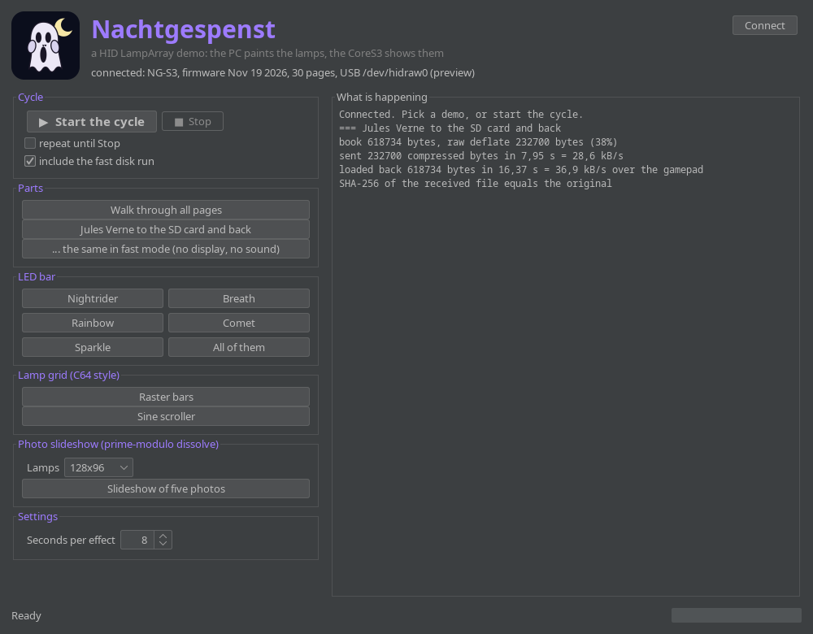
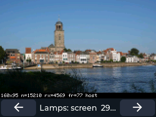

# The demo: a window with buttons

`jbang tools/DemoApp.java` opens a window (Swing, FlatLaf dark theme) with the Nachtgespenst ghost of the site. Everything is painted by the **PC** through the HID LampArray of a **CoreS3 over USB**; nothing is uploaded to the board. Every demo runs on a virtual thread (Java 27), and **Stop** interrupts it. Start it as one plain command (it needs the serial port and `/dev/hidraw`); `jbang tools/Demo.java` does the same without a window (`--cycles 0` loops until Ctrl-C, `--only pages,disk,bar,grid,photos`, `--shots DIR` saves the board's screen after every photo).

## The buttons

| Part | What it does |
|---|---|
| **Start the cycle** | every part in turn; "repeat until Stop" loops; "include the fast disk run" adds the run without display and sound |
| Walk through all pages | `LAYER n` for every page (no key or tap is sent, so Power Down and Sleep are never pressed) |
| Jules Verne to the SD card and back | the [Disk demo](disk-drive.md): the compressed book over the lamps, unpacked and written to the SD card, then back over the game pad buttons, SHA-256 on both ends |
| ... in fast mode | the same without display, LED bar and sound on the board |
| LED bar | Nightrider, breath, rainbow, comet, sparkle on the ten bar lamps |
| Lamp grid | C64-style raster bars and a sine scroller on a 40 x 25 grid with the 16 C64 colours |
| Photo slideshow | five photos on the lamp grid, dissolved into each other with a prime modulus |

## Photo slideshow: the dissolve with primes

Lamp `i` gets the rank `(i * p) mod m`, with `m` the first prime above the number of lamps and `p` another prime. Because `p` and `m` have no common divisor all ranks are different: the lamps are visited in a scattered but regular order, without a table. A threshold climbs from 0 to `m` and a lamp switches to the next photo when its rank falls below it. A small `p` (7) switches neighbouring lamps together (stripes, a moire), a `p` near 0.618 `m` scatters evenly; the slideshow uses 7, 31, a golden-ratio prime, 97 and 211.

The grids are chosen so that the lamps fill the 320 x 190 pixel lamp area with whole pixels: **160 x 95** (2 x 2 pixels per lamp, 15,200 lamps, the default), 64 x 38 (5 x 5) and 320 x 190 (every pixel, 60,800 lamps). A transition writes every lamp once, as multi updates of eight lamps with a full 24-bit colour, so its duration is the number of lamps divided by about 8,000 lamps per second: 160 x 95 takes **1.9 s** (measured), 320 x 190 about 8 s. Colours cost nothing extra. The 16-colour look belongs to the C64 effects, not to the photos.

Photos (fetched once from Wikimedia Commons at 640 pixels into `tools/data/photos`, not committed): *The Blue Marble* (NASA, public domain), *Earthrise* (Apollo 8, NASA, public domain), *Statue of Liberty* (public domain), *Pillars of Creation* (Hubble, NASA/ESA, public domain) and *Deventer seen from across the IJssel* by Smiley.toerist (CC BY-SA 4.0, https://commons.wikimedia.org/wiki/File:Deventer_aan_de_IJssel_2024.jpg).

## How the code is organised

`tools/` holds small JBang programs and shared classes (a `//SOURCES` list at the top of each program):

| File | Contents |
|---|---|
| `Libc`, `Hid`, `HidReader`, `Evdev`, `Ser` | libc through the foreign function API, the HID node (output, feature and input reports), the keyboard device with `EVIOCGRAB`, and the serial protocol; the readers are virtual threads |
| `Proto` | report builders (multi, range, control), the Disk block format, hashes and compression |
| `DiskDrive` | the whole Disk demo from the PC side (SAVE and LOAD, variable bit rate, checks), used by `LampTest disk` and by the demo |
| `Canvas` | a lamp grid with `present()`: only the lamps that changed, runs of one colour as range updates |
| `BarEffects`, `GridEffects`, `Photos` | the effects and the photo loader |
| `Scenarios` | the demo parts, shared by `Demo` and `DemoApp` |
| `LampTest` | the LampArray test bench ([lamparray-testing](lamparray-testing.md)) |
