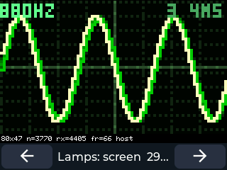
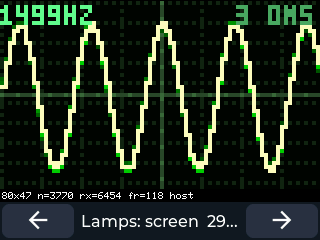

# Bar effects, the microphone and the oscilloscope

## Where the bar lamps are
The ten LEDs of the base are one chain in the shape of a U, measured with the webcam ([lamparray-testing](lamparray-testing.md)): lamps 0 to 4 run down the right side (0 at the top), lamps 5 to 9 run up the left side (9 at the top). The position attributes of the LampArray follow that (the lamps on the 54 mm edges of the base, the 9.5 mm pitch an estimate), and the screen lamps are a logical grid over the panel with a higher Z than the bar lamps.

## Effects on the board itself
`set effect nightrider|breath|rainbow|comet|sparkle|vu|none` (stored in the settings) runs an effect on the layer pages in the colour of the layer, without any lamp update: Nightrider (both sides together, up and down), breath, rainbow (down both sides), comet (along the chain: down the right side, round the bottom, up the left side), sparkle and a **VU meter** that follows the microphone. A task on the second core draws them 60 times a second. The demo window's section "On the board itself" starts them. The effects the PC paints through the LampArray (the section "LED bar") use the same mapping.

## The microphone
The speaker and the microphone are set up at start (the speaker stays at volume 0 until the Disk page plays its modem sounds). `mic on|off` switches sampling on, `mic` shows level, peak and the dominant frequency (from zero crossings). The speaker and the microphone share the I2S port on the Core2, so the speaker is off while the microphone listens.

Test: `jbang tools/LampTest.java mic --board S3` plays silence and tones of 440, 1000 and 2000 Hz through the speaker of the PC (`javax.sound`, no Linux tools) and checks that each tone is louder than the silence and that the frequency the board hears is within 10%. Measured on the CoreS3: 442, 1000 and 2000 Hz.

## Telemetry over the game pad
The demo window does not read the serial port for what it shows. `telem bar|wave|both|off` makes the board send **game pad reports** (HID report 11, the 48-byte layout of the Disk demo): flags 0x04, the ten bar colours as 10 x (r, g, b), 25 times a second; flags 0x08, the microphone frame in 14 chunks (a 16-bit divisor and 512 signed bytes of the last 32 ms buffer), with 0x01 on the last chunk. A virtual thread on the PC reads them from the HID node (`Telemetry.java`). `bar` and `wave` over serial are only for tests.

## The oscilloscope on the lamps
The PC takes the waveform from the telemetry and paints an oscilloscope on the **80 x 47 lamp grid** (4 x 4 pixels per lamp) with ordinary lamp updates, so it shows on the screen of the board and in the demo window at the same time (`Scope.java`): a graticule of 8 x 8 divisions, a trigger on the rising zero crossing so that the trace stands still, a time base chosen so that about three periods fit, automatic amplitude, a trace that glows and fades like phosphor, and the frequency and the time base in a 3 x 5 pixel font. About 13 frames a second; the limit is the lamp updates (a finer grid of 160 x 95 gave 4).

## In the demo window
Section "Microphone and oscilloscope (the PC plays tones)": the oscilloscope on the lamps, the VU meter on the LED bar, and a microphone check with pass or fail. The checkbox "include the microphone parts" adds them to the cycle.
